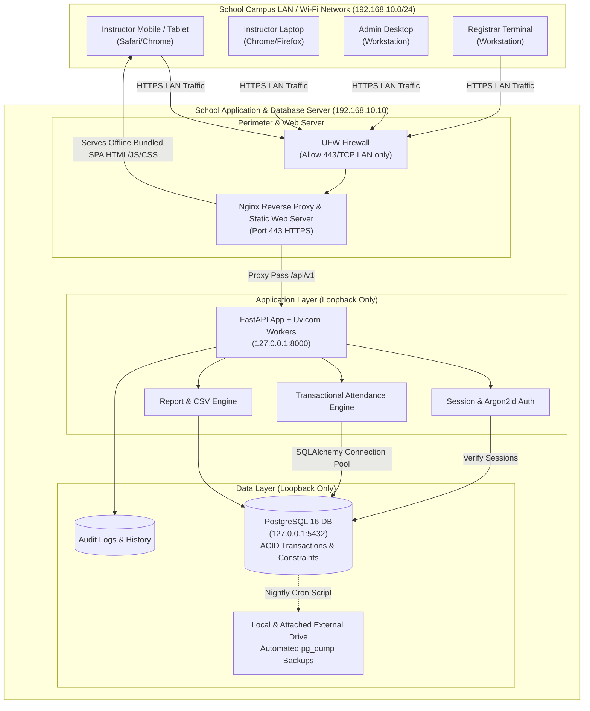

# CampusAttend: System Architecture & Offline Network Topology

## 1. High-Level Architecture Overview

CampusAttend implements an on-premises **Three-Tier Architecture** tailored specifically for air-gapped or offline school local area networks (LAN). All services execute on a dedicated on-premises institutional workstation or rackmount server running Ubuntu Server (or Windows Server/Workstation for local development).

---

## 2. Request & Network Flow Details

1. **Client DNS Resolution:**
   - Client device connects to authorized School Wi-Fi SSID (`Campus-Faculty` or `Campus-Staff`).
   - The school's router or local DNS server (e.g., dnsmasq / Pi-hole / Windows DNS) resolves `https://attendance.school.lan` to `192.168.10.10`.
   - No public internet DNS queries occur.

2. **Perimeter Defense (Nginx & Firewall):**
   - The server firewall (UFW) strictly permits incoming TCP traffic on port `443` (HTTPS) from authorized subnets (e.g., `192.168.10.0/24`).
   - Port `80` (HTTP) automatically redirects to `443` (HTTPS).
   - Direct external internet access is prohibited; no port forwarding is configured on the edge gateway router.
   - Database port `5432` is bound to `127.0.0.1` only and is inaccessible to client devices on the LAN.

3. **Static Asset Delivery (Zero Internet Dependency):**
   - Nginx directly serves the pre-compiled Single-Page Application (React + Vite + Tailwind CSS).
   - All fonts (e.g., Inter / Outfit), icon SVG packs (Lucide React), and styling rules are compiled directly into `/var/www/campus-attend/dist`.
   - Zero runtime CDN calls (`cdn.jsdelivr.net`, `fonts.googleapis.com`, etc.) are made.

4. **API Proxying & Application Execution:**
   - Any HTTP request with the `/api/v1/` prefix is proxied by Nginx via loopback socket to `http://127.0.0.1:8000`.
   - FastAPI handles routing, request validation via Pydantic models, rate-limiting, and authentication.
   - FastAPI connects to PostgreSQL via SQLAlchemy over a local loopback connection pool.

---

## 3. Offline-Specific Design Principles

| Constraint | Architectural Decision |
|---|---|
| **No Public Internet Access** | All client libraries, JS bundles, and stylesheets are bundled during build time. |
| **No Cloud Auth (Firebase, Auth0)** | Self-hosted session authentication using Argon2id password hashing and server-side state stored in PostgreSQL. |
| **Untrusted Client Environment** | Full server-side authorization enforcement. Roster IDs, enrollment verification, and submission statuses validated at API endpoints. |
| **Sudden LAN Disconnection** | The frontend implements optimistic validation with robust connection-failure alerts, preventing data loss if an instructor's Wi-Fi drops mid-grading. |
| **Concurrent Submissions** | Meeting status transitions (`draft` -> `submitted`) use atomic SQL row locking (`SELECT ... FOR UPDATE`) and database transactions. |
