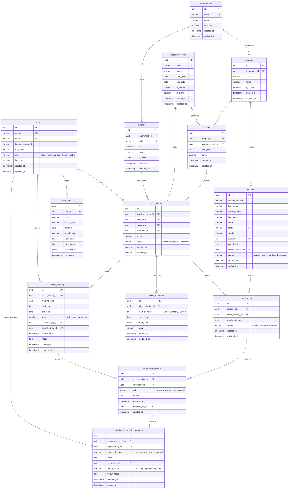

# CampusAttend: Database Schema & Entity-Relationship Design

## 1. Entity-Relationship Diagram (ERD)

---

## 2. Table Schemas, Constraints & Business Rules

### 2.1 Table: `users`
- Stores system accounts.
- **Constraints:**
  - `username` UNIQUE NOT NULL
  - `email` UNIQUE NOT NULL
  - `role` CHECK (`role IN ('admin', 'instructor', 'dept_head', 'registrar')`)
- **Retention:** `is_active=false` prevents authentication while preserving relational integrity with past class meetings and audit logs.

### 2.2 Table: `students`
- Master directory of enrolled students.
- **Constraints:**
  - `student_number` UNIQUE NOT NULL (e.g., `2024-00123`).
  - `status` CHECK (`status IN ('active', 'inactive', 'graduated', 'dropped')`).
  - Foreign key to `programs(id)` (ON DELETE RESTRICT).
  - Foreign key to `sections(id)` (ON DELETE SET NULL).
- **Index:** `CREATE INDEX idx_students_search ON students (student_number, last_name, first_name);`

### 2.3 Table: `enrollments`
- Binds a student to a class offering.
- **Critical Constraint:** 
  - `UNIQUE(student_id, class_offering_id)`: A student cannot be enrolled in the same class offering more than once.
  - `status` CHECK (`status IN ('enrolled', 'dropped', 'withdrawn')`).
- **Referential Integrity:** `ON DELETE RESTRICT` on both `student_id` and `class_offering_id`. Historical enrollments must never be hard-deleted if attendance records exist.

### 2.4 Table: `class_meetings`
- Represents a specific session of a class offering on a calendar date.
- **Critical Constraint:**
  - `UNIQUE(class_offering_id, meeting_date)`: Only one meeting record per class offering per calendar date (unless schedule supports split labs, in which case unique by offering + date + start_time).
  - `status` CHECK (`status IN ('draft', 'submitted', 'closed')`).
- **Index:** `CREATE INDEX idx_meetings_offering_date ON class_meetings(class_offering_id, meeting_date);`

### 2.5 Table: `attendance_records`
- Individual attendance entries per student per class meeting.
- **Critical Constraints:**
  - `UNIQUE(class_meeting_id, enrollment_id)`: Guarantees exactly one attendance record per enrolled student per class meeting. Duplicate attendance records are impossible at the database level.
  - `status` CHECK (`status IN ('present', 'absent', 'late', 'excused')`).
- **Validation Rule:** Before inserting an attendance record, the application confirms via transaction that `enrollment.class_offering_id == class_meeting.class_offering_id`.
- **Index:** `CREATE INDEX idx_attendance_records_meeting ON attendance_records(class_meeting_id);`
- **Index:** `CREATE INDEX idx_attendance_records_enrollment ON attendance_records(enrollment_id, status);`

### 2.6 Table: `attendance_correction_requests`
- Manages formal requests by instructors to correct submitted attendance.
- **Constraints:**
  - `requested_status` CHECK (`requested_status IN ('present', 'absent', 'late', 'excused')`).
  - `review_status` CHECK (`review_status IN ('pending', 'approved', 'rejected')`).
  - Foreign key to `attendance_records(id)`.
  - When approved, updates `attendance_records.status` and logs an entry in `audit_logs`.

### 2.7 Table: `audit_logs`
- Immutable event stream of security and data mutations.
- **Characteristics:**
  - Append-only. No `UPDATE` or `DELETE` operations permitted via application endpoints.
  - Stores `old_values` and `new_values` as PostgreSQL `JSONB` for deep structural diffs.
- **Index:** `CREATE INDEX idx_audit_logs_user_ts ON audit_logs(user_id, timestamp DESC);`
- **Index:** `CREATE INDEX idx_audit_logs_entity ON audit_logs(entity_type, entity_id);`
