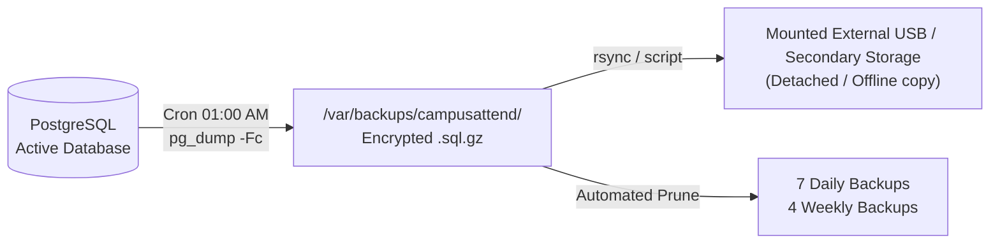

# CampusAttend: Security, Privacy & Offline-Operation Plan

## 1. Network & Offline Security Architecture

### 1.1 Air-Gapped / Isolated Local Area Network Operation
1. **Network Boundary Enforcement:**
   - The application server operates within the institutional subnet (e.g., `192.168.10.0/24`).
   - The edge router does NOT forward incoming WAN traffic or expose any ports to the public internet.
   - Internal firewall (UFW) permits incoming connections only to TCP Port `443` (HTTPS) from authorized local subnets (`192.168.10.0/24`, `192.168.20.0/24` for Wi-Fi).
2. **Loopback Service Isolation:**
   - PostgreSQL binds strictly to `127.0.0.1:5432` with `listen_addresses = 'localhost'` in `postgresql.conf`. Direct connection from client devices is impossible.
   - FastAPI / Uvicorn binds strictly to `127.0.0.1:8000`.
   - Nginx is the sole process listening on external interfaces.
3. **Internal PKI & HTTPS:**
   - HTTPS is mandatory to protect session cookies and student data traversing the school's Wi-Fi network.
   - An internal School Certificate Authority (CA) generates a certificate for `attendance.school.lan`.
   - The School Root CA is distributed and installed to school-managed devices and instructor browsers via standard IT procedures or Active Directory / MDM / manual import.

---

## 2. Application Security Controls

### 2.1 Password Hashing & Authentication
- **Algorithm:** **Argon2id** (the state-of-the-art password hashing standard recommended by OWASP).
- **Parameters:**
  - Memory cost: 65,536 KiB (64 MiB)
  - Time cost: 3 iterations
  - Parallelism: 4 threads
- **Session Security:**
  - 256-bit cryptographically secure session IDs generated via `secrets.token_urlsafe(32)`.
  - Session tokens transmitted solely via `Set-Cookie` headers with flags:
    - `HttpOnly`: Inaccessible to client JavaScript, mitigating XSS session theft.
    - `SameSite=Lax`: Defends against Cross-Site Request Forgery (CSRF).
    - `Secure`: Transmitted solely over TLS/HTTPS.
  - Absolute session lifetime: 8 hours; Inactive sliding window: 60 minutes.
  - Zero storage of tokens or role claims in browser `localStorage`.

### 2.2 Rate Limiting & Brute Force Prevention
- In-memory rate limiting applied to `/api/v1/auth/login`:
  - Limit: Maximum 5 failed attempts per client IP / username per 5 minutes.
  - Exponential backoff / temporary account freeze upon exceeding threshold.

### 2.3 SQL Injection & Input Sanitization
- 100% Parameterized queries enforced via SQLAlchemy ORM. No raw SQL concatenation.
- Strict Pydantic schema validation for every incoming request payload.

---

## 3. Philippine Data Privacy Act of 2012 (RA 10173) Compliance

CampusAttend complies with the statutory mandates of the National Privacy Commission (NPC) and RA 10173:

1. **Lawful Basis & Purpose Limitation:** Student personal data (names, IDs, enrollment records, attendance marks) is processed strictly for academic management, student retention, and institutional accreditation.
2. **Data Minimization:** No unnecessary biometrics, facial recognition, geolocation, or personal contact tracking are collected.
3. **Role-Based Access Control (RBAC):** Instructors can only view rosters of their currently assigned subjects. Department heads can only access students within their department.
4. **Auditability (Section 20):** Every modification to a student profile, attendance record, or user privilege generates an immutable entry in `audit_logs` storing the timestamp, user ID, IP address, and JSON diff.
5. **Data Retention & Disposal:**
   - Active academic data retained throughout the student's enrollment lifecycle.
   - Archived records maintained in accordance with Commission on Higher Education (CHED) record-keeping guidelines.
6. **Breach Protocol:** Any unauthorized export or security anomaly triggers internal IT notification and incident investigation.

---

## 4. Backup & Disaster Recovery Plan

1. **Daily Automated Snapshot:**
   - Scheduled `systemd` timer or cron runs `pg_dump -Fc` every night at 01:00 AM.
   - Output files compressed and timestamped: `campusattend_backup_YYYYMMDD_HHMMSS.dump`.
2. **Off-Server Copy:**
   - Dedicated script synchronizes backup archives to an attached external drive or secondary school backup storage.
3. **Retention Policy:**
   - Retain last 7 daily snapshots and 4 weekly snapshots; automatically purge older archives to prevent storage exhaustion.
4. **Restoration Testing Protocol:**
   - Monthly scheduled restoration rehearsal onto a test database instance to verify database integrity.
